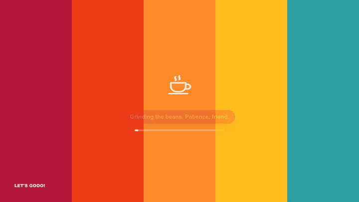
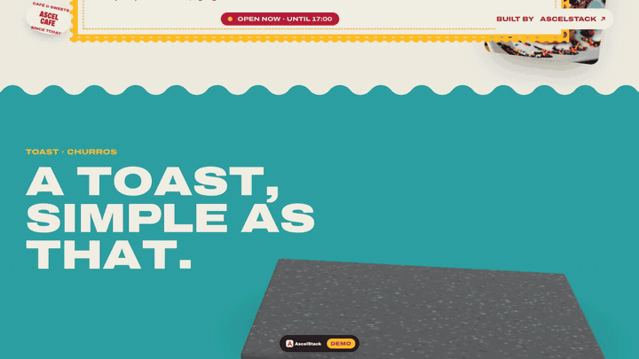
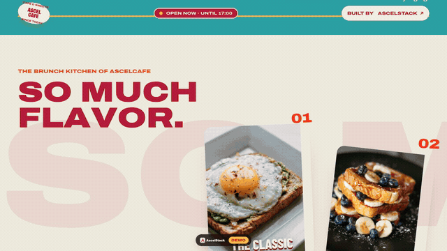
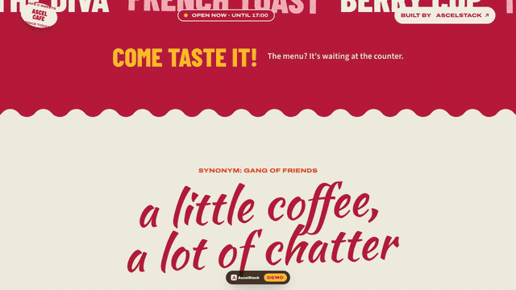
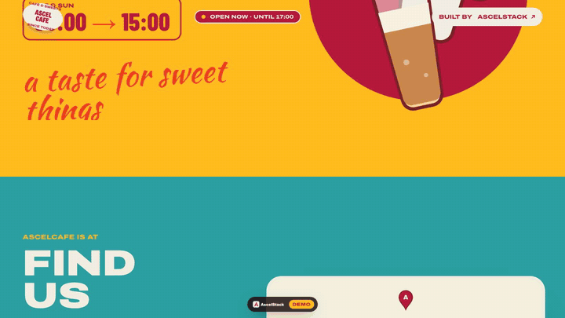
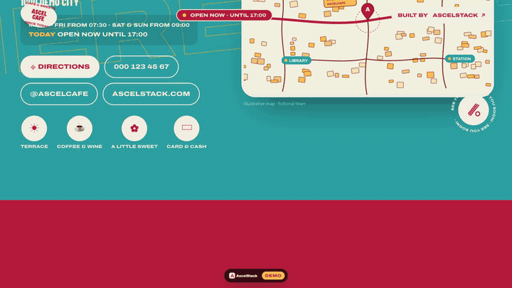
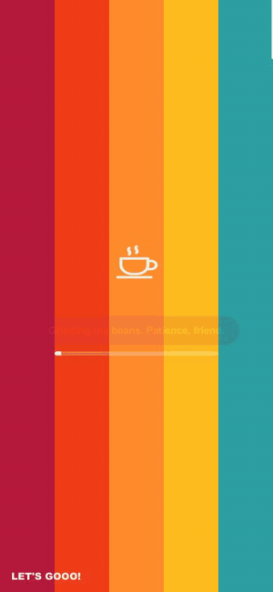

# Ascelcafe — Café & Sweets

**An animated, 3D café website designed & developed by [AscelStack](https://ascelstack.com).**

Ascelcafe is a fictional café, built as a showcase of what AscelStack creates for cafés, bakeries and restaurants.

[**ascelstack.com**](https://ascelstack.com) · Want a website like this for your café? [Get in touch](https://ascelstack.com).

---

> [!IMPORTANT]
> **This is a commercial, proprietary project — not open source and not free to use.**
> The source code, design, 3D models, animations and content are © 2026 AscelStack. All rights reserved.
> You may view this repository, but you may not copy, install, modify, redistribute, deploy or use any part of it
> (personally or commercially) without written permission from AscelStack. See [LICENSE](LICENSE).
> For a licence or a custom website, contact us at [ascelstack.com](https://ascelstack.com).

---

## Live previews

### Intro & hero
Five colour panels, a loading cup and a real progress bar. The letters drop and bounce, the curtain lifts,
and a hand-built 3D toast floats with mouse parallax among beans, tomatoes and churros.

### The toast builds itself — scroll-driven 3D

Pinned section: the bread bounces in, then tomato spread, avocado fan, a fried egg and salt rain land on it. It spins, then turns into a mug with churros.

### Horizontal gallery

Vertical scroll drives a horizontal track. Cards straighten as they pass, images move with parallax, titles pop in.

### Ink-to-photo reveal & opening hours

A hand-drawn ink illustration wipes into the real photo. A brush-stroke script follows. The hours show live open/closed status and highlight today.

### Find us — animated map

Roads draw themselves on scroll, the pin drops and bobs, and the card tilts in 3D.

### Finale — physics food rain

Elastic "LET'S GOOO!" letters, plus a 2D physics rain of rendered 3D toasts, mugs and churros you can push around.

### Fully responsive

Every section is tuned for phones, tablets and desktops, with touch and gyro support. Animation is reduced for users who prefer reduced motion.

---

## What's inside

| | |
|---|---|
| **Framework** | Astro, static and very fast |
| **Motion** | GSAP: ScrollTrigger, SplitText, CustomEase |
| **Smooth scroll** | Lenis |
| **3D** | Three.js, every food model built procedurally in code (no downloaded assets) |
| **Effects** | SVG ink filters, CSS masks for wavy edges and stamp perforations, canvas physics |
| **Hosting** | Cloudflare Pages: global CDN, security & cache headers |
| **Extras** | Custom cursor with labels, magnetic buttons, live open/closed status, 404 page, SEO meta & JSON-LD |

**Performance:** 3D scenes render only while visible, images are preloaded behind the intro, and the site runs at 60 fps on modern devices.

---

## About AscelStack

AscelStack designs and builds high-end websites with motion, 3D and fast hosting
for cafés, restaurants and local brands.

**→ [ascelstack.com](https://ascelstack.com)**

© 2026 AscelStack. All rights reserved. Ascelcafe is a fictional café created by AscelStack for demonstration purposes. Photos are used for demonstration only.
